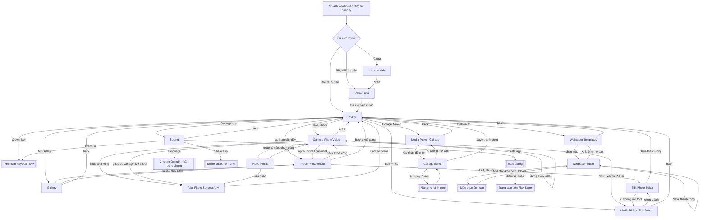

# vga52a-kotlin — Luồng di chuyển màn hình

## 1. Sơ đồ tổng quan

## 2. Bảng chi tiết vào/ra từng màn

| # | Màn hình | Vào từ (nguồn) | Điều kiện/ghi chú khi vào | Ra tới (đích) | Điều kiện/ghi chú khi ra |
|---|---|---|---|---|---|
| 1 | **Intro** | Điểm khởi đầu app (nếu thuộc diện cần xem Intro) | Người dùng mới/chưa qua Intro | Permission | Luôn luôn, khi bấm "Start" ở slide 4. Intro bị xoá khỏi lịch sử (không back lại được). |
| 2 | **Permission** | Intro (Start) hoặc điểm khởi đầu trực tiếp | Cho người dùng cũ chưa cấp đủ quyền camera/micro | Home | (a) cấp đủ Camera + Audio (tự động), hoặc (b) bấm "Skip". |
| 3 | **Home** | Permission, hoặc điểm khởi đầu trực tiếp (đã qua Intro + đủ quyền), hoặc quay về sau khi hoàn tất 1 luồng tạo nội dung | — | Camera / Setting / Gallery / EditPhotoPicker / CollagePicker / WallpaperTemplates / ImportPhotoResult / Premium Paywall | Các mục chính (Camera/Gallery/Edit Photo/Collage/Wallpaper) có thể hiện quảng cáo interstitial (`inter_home`) trước khi điều hướng thật sự xảy ra. |
| 4 | **Camera** (Photo/Video) | Home (Take Photo, qua `inter_home`), hoặc màn chọn ảnh (nút "+" — không đổi route, mở đè tại chỗ) | Tự xin quyền Camera nếu chưa có | Home (nút X, vào từ Home) / màn chọn ảnh (nút X, vào từ đó) / TakePhotoSuccessfully (chụp ảnh xong hoặc ghép Collage xong) / ImportPhotoResult (tap thumbnail gần nhất) | Chụp 1 ảnh đơn không tự điều hướng — ở lại Camera để chụp tiếp. Dừng quay video **hiện không** mở VideoResult (route có sẵn nhưng không được gọi trong luồng thật) — video tự lưu, ở lại Camera. |
| 5 | **VideoResult** | Về mặt hệ thống: Camera sau khi dừng quay (**hiện chưa được kích hoạt** trong luồng thật — xem mục 01, phần Camera §7.4/§9) | Nhận đường dẫn video + độ rộng preview | Camera (huỷ, nút X) / TakePhotoSuccessfully (xác nhận, nút ✓) | Xác nhận: xoá các màn từ Home tới đó khỏi lịch sử trước khi vào Success. |
| 6 | **TakePhotoSuccessfully** | Camera (ảnh đã lưu) hoặc VideoResult (video đã xác nhận) | Cả 2 nguồn đều xoá bớt lịch sử về Home trước khi vào | Home | Duy nhất 1 lối ra ("Back to home"), xoá sạch lịch sử phía sau — không back lại Camera/Success được nữa. |
| 7 | **ImportPhotoResult** (chi tiết ảnh/video) | Camera (tap thumbnail gần nhất) / Home (tap item gần đây) / Gallery (tap item) | Nhận đường dẫn file + cờ isVideo | Quay lại đúng nơi đã mở tới (Camera/Home/Gallery) — qua back hoặc sau khi xoá xong / EditPhotoScreen (nút Edit, chỉ với ảnh) | Xoá thành công → tự đóng màn, không còn cách xem lại file đã xoá. |
| 8 | **Gallery** | Home (My Gallery, qua `inter_home`) | 3 tab Photo/Video/Templates, mặc định "xem tất cả media máy" tắt | ImportPhotoResult (tap item) / Home (back) | Công tắc "xem tất cả media máy" luôn reset về tắt mỗi lần vào lại Gallery. |
| 9 | **MediaPickerScreen — Edit Photo** (`title="Edit Photo", multiSelect=false`) | Home (Edit Photo, qua `inter_home`) | Chọn 1 ảnh | EditPhotoScreen (chọn ảnh — điều hướng ngay, không cần xác nhận) / Home (back) | Route **không** bị gỡ khỏi lịch sử khi vào Editor — để nút X trong Editor quay lại đúng màn này. |
| 10 | **EditPhotoScreen** (Editor chính) | MediaPickerScreen (Edit Photo, đã chọn 1 ảnh) hoặc ImportPhotoResult (nút Edit) | Nhận đường dẫn ảnh nguồn | MediaPickerScreen — Edit Photo (nút X, không mở tool nào) / Home (Save thành công) | Save thành công: xoá sạch lịch sử phía sau kể cả màn chọn ảnh — back sau đó không quay lại Editor/Picker được. |
| 11 | **MediaPickerScreen — Collage Maker** (`title="Collage Maker", multiSelect=true`) | Home (Collage Maker, qua `inter_home`) | Chọn nhiều ảnh, xác nhận qua icon tick | CollageMakerScreen (xác nhận danh sách đã chọn) / Home (back) | Route **không** bị gỡ khỏi lịch sử khi vào Editor. |
| 12 | **CollageMakerScreen** (Editor) | MediaPickerScreen — Collage Maker (đã xác nhận danh sách ảnh) | Nhận danh sách đường dẫn ảnh | MediaPickerScreen — Collage Maker (nút X, không mở tool nào) / màn chọn ảnh con (Add / tap 1 ô ảnh — quay lại đúng Editor sau khi chọn xong) / Home (Save thành công) | Save thành công: thoát hẳn luồng về Home, back không quay lại Picker được nữa. |
| 13 | **WallpaperTemplatesScreen** | Home (Wallpaper, qua `inter_home`) | Danh sách mẫu tự liệt kê từ tài nguyên | WallpaperEditorScreen (chọn 1 mẫu, mang theo mã mẫu) / Home (back) | Chạm mẫu premium vẫn mở Editor bình thường — chưa có bước chặn thanh toán thật. |
| 14 | **WallpaperEditorScreen** | WallpaperTemplatesScreen (đã chọn mẫu, mã 0 = canvas trống) | Mẫu có thể có "khe hở" ảnh dựng sẵn | WallpaperTemplatesScreen (nút X, không mở tool nào) / màn chọn ảnh con (chạm khe hở / Add / Upload — quay lại đúng Editor) | Save thành công: **không tự điều hướng** — chỉ hiện dialog "Set as Wallpaper?", người dùng vẫn ở lại Editor sau khi đóng dialog (khác Collage Maker). |
| 15 | **Setting** | Home (icon bánh răng) | — | Home (back) / màn chọn ngôn ngữ dùng chung (Language) / Share sheet hệ thống (Share app) / Rate dialog nội bộ (Rate app, ở lại Setting) / Premium Paywall / Play Store (chỉ khi Rate ≥ 4 sao) | — |

## 3. Quy tắc back-stack (lịch sử điều hướng) cần lưu ý

Đây là các quy tắc **không hiển nhiên nếu chỉ nhìn giao diện**, phải đọc code điều hướng mới biết:

1. **Xoá sạch lịch sử về Home** khi hoàn tất "tạo nội dung": lưu ảnh chỉnh sửa xong (Edit Photo), lưu
   collage xong, và khi bấm "Back to home" ở màn Success — cả 3 trường hợp đều xoá toàn bộ back-stack
   phía sau, để người dùng không back ngược lại được vào giữa 1 luồng tạo nội dung đã hoàn tất.
2. **Giữ nguyên back-stack** ở 2 màn chọn ảnh (Edit Photo Picker, Collage Picker): khi vào Editor,
   route của màn chọn ảnh KHÔNG bị gỡ — để nút "X" (huỷ, không lưu) trong Editor quay lại đúng màn
   chọn ảnh thay vì rơi thẳng về Home. Đây là điểm khác biệt so với Wallpaper (không có bước "gỡ hay
   giữ" vì Wallpaper Editor không tự điều hướng đi đâu sau khi lưu).
3. **Chụp ảnh trong luồng phụ** (nút "+" ở màn chọn ảnh): không tạo route mới — Camera được vẽ đè
   ngay tại chỗ trong màn chọn ảnh, nên "vào/ra Camera" ở luồng này không ảnh hưởng gì tới back-stack
   chính của app.
4. **Route khai báo sẵn nhưng không dùng tới** (`VideoResult`): hệ thống có route/tham số đầy đủ cho
   1 màn "xem lại trước khi lưu", nhưng luồng nghiệp vụ thực tế lại không gọi tới.
5. **Wallpaper Editor không tự rời màn sau khi lưu** (khác Collage Maker/Edit Photo tự về Home) — vì
   sau khi lưu còn cần hỏi người dùng có muốn đặt làm hình nền máy hay không; đây là lựa chọn thiết kế
   có chủ đích, không phải thiếu sót.

## 4. Điều hướng KHÔNG đổi route (overlay/dialog trong cùng 1 màn)

Một số "điều hướng" trong mô tả chức năng thực chất chỉ là mở overlay/dialog ngay trong màn hiện tại,
không tạo màn mới trong lịch sử điều hướng:

- Mọi **panel công cụ** trong Edit Photo/Collage Maker/Wallpaper Editor (Frame/Text/Filter/Sticker/
  Draw/Background/Layout/Ratio/Margin) — đóng/mở tại chỗ trên cùng 1 màn Editor.
- **Menu "More" + bảng chọn tỉ lệ + 5 bảng chỉnh màu** trong Camera — đều là overlay trong cùng màn
  Camera.
- **Camera nhúng trong màn chọn ảnh** (nút "+") — vẽ đè tại chỗ, không phải điều hướng sang màn khác.
- **Rate dialog** (Setting), **dialog Info/Delete** (ImportPhotoResult), **dialog "Set as Wallpaper?"**
  (Wallpaper Editor) — đều là dialog nổi trên màn hiện tại, đóng xong vẫn ở nguyên màn đó.
