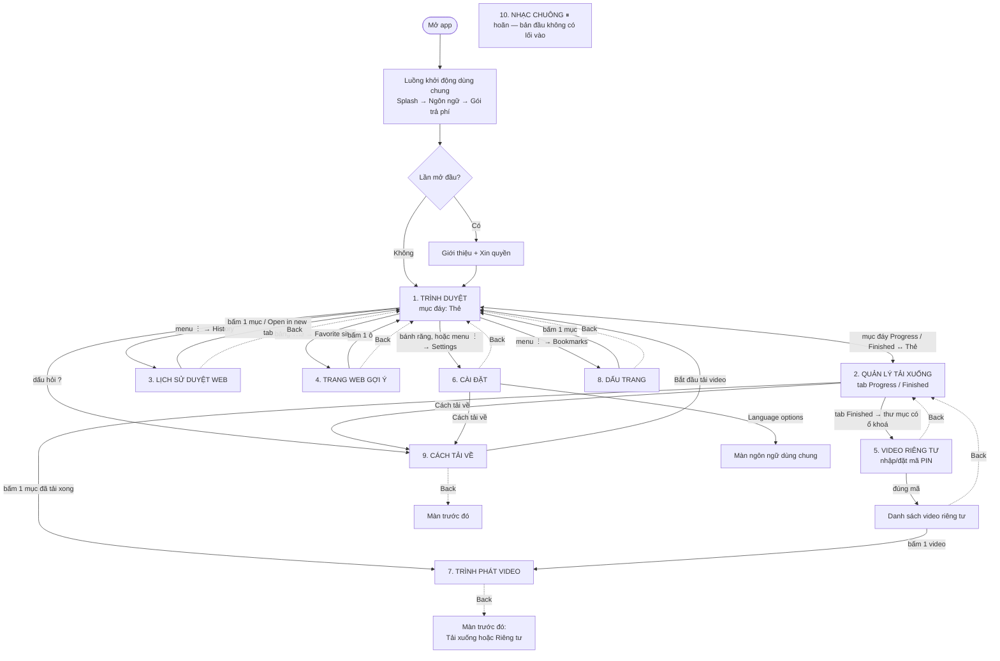

# Video Downloader — Luồng di chuyển màn hình

> Tên màn hình trong tài liệu này khớp 1-1 với
> [`01_MO_TA_CHUC_NANG_MAN_HINH.md`](01_MO_TA_CHUC_NANG_MAN_HINH.md).
>
> Phân biệt quan trọng: **Trình duyệt** và **Quản lý tải xuống** là 2 màn được chuyển qua lại bằng
> thanh điều hướng đáy (ngang hàng nhau); các màn còn lại **mở chồng lên** và thoát bằng nút quay lại.

## 1. Sơ đồ tổng quan

## 2. Bảng chi tiết vào/ra từng màn

| # | Màn hình | Vào từ (nguồn) | Điều kiện/ghi chú khi vào | Ra tới (đích) | Điều kiện/ghi chú khi ra |
|---|---|---|---|---|---|
| 1 | **Trình duyệt** | Mở app | Sau luồng khởi động dùng chung + (lần đầu) màn Giới thiệu/Xin quyền | Quản lý tải xuống | Bấm mục đáy `Progress` hoặc `Finished` |
| | | Quản lý tải xuống | Bấm mục đáy `Thẻ`, hoặc biểu tượng 🌐 trên 1 thẻ mục tải (mở lại trang nguồn) | Lịch sử duyệt web | Menu ⋮ → `History` |
| | | Lịch sử / Trang web gợi ý / Cài đặt / Dấu trang / Cách tải về | Bấm quay lại, hoặc bấm 1 mục trong danh sách | Trang web gợi ý | Bảng danh sách thẻ → `Favorite sites` |
| | | | | Cài đặt | Bánh răng (chỉ hiện ở trang chủ) **hoặc** menu ⋮ → `Settings` |
| | | | | Dấu trang | Menu ⋮ → `Bookmarks` |
| | | | | Cách tải về | Biểu tượng dấu hỏi ở trang chủ |
| | | | | Bảng chia sẻ hệ thống | Menu ⋮ → `Chia sẻ` |
| 2 | **Quản lý tải xuống** | Trình duyệt | Bấm mục đáy `Progress`/`Finished`; tab mở đúng theo mục vừa bấm | Trình duyệt | Bấm mục đáy `Thẻ`, hoặc 🌐 trên 1 thẻ mục tải |
| | | Thông báo tiến trình tải | Chạm thông báo ngoài app → mở thẳng tab `Progress` | Video riêng tư | Chỉ ở tab `Finished` → biểu tượng thư mục có ổ khoá |
| | | | | Trình phát video | Bấm 1 mục đã tải xong, hoặc menu ⋮ → `Phát` |
| | | | | Cách tải về | Bấm dải `Cách tải về` (chỉ hiện khi danh sách rỗng) |
| 3 | **Lịch sử duyệt web** | Trình duyệt | Menu ⋮ → `History` | Trình duyệt | Back / bấm 1 mục (tải trong thẻ hiện tại) / `Open in new tab` (tải trong thẻ mới) |
| | | | | Bảng chia sẻ hệ thống | Menu của mục → `Chia sẻ` |
| 4 | **Trang web gợi ý** | Trình duyệt | Mở bảng danh sách thẻ → `Favorite sites` | Trình duyệt | Back / bấm 1 ô (tải trong **thẻ hiện tại**) |
| 5 | **Video riêng tư (mã PIN)** | Quản lý tải xuống | Tab `Finished` → thư mục có ổ khoá | Quản lý tải xuống | Back |
| | | | | Danh sách video riêng tư | Nhập đúng mã 4 số (lần đầu phải nhập 2 lần để đặt) |
| 5b | **Danh sách video riêng tư** | Màn nhập mã PIN | Sau khi mở khoá | Quản lý tải xuống | Back — **không** quay lại màn nhập mã |
| | | | | Trình phát video | Bấm 1 video |
| 6 | **Cài đặt** | Trình duyệt | Bánh răng / menu ⋮ → `Settings` | Trình duyệt | Back |
| | | | | Cách tải về | Mục `Cách tải về` trong nhóm `Help` |
| | | | | Màn ngôn ngữ dùng chung | Mục `Language options` |
| | | | | Bộ chọn thư mục hệ thống | Mục `Download location` |
| | | | | Trang chính sách bảo mật | Mục `Chính sách bảo mật` — mở trong trình duyệt của app |
| 7 | **Trình phát video** | Quản lý tải xuống (tab `Finished`) hoặc Danh sách riêng tư | Bấm 1 video | Màn trước đó | Back — trả về đúng nơi đã vào |
| | | | | Bảng chia sẻ hệ thống | Biểu tượng chia sẻ |
| 8 | **Dấu trang** | Trình duyệt | Menu ⋮ → `Bookmarks` | Trình duyệt | Back / bấm 1 mục / `Open in new tab` |
| 9 | **Cách tải về** | Trình duyệt (dấu hỏi) · Quản lý tải xuống (nút `Cách tải về`) · Cài đặt (mục `Cách tải về`) | **3 lối vào, cùng 1 màn đích** | Màn trước đó | Back |
| | | | | Trình duyệt | Nút `Bắt đầu tải video` — luôn về Trình duyệt bất kể vào từ đâu |
| 10 ⏸ | **Nhạc chuông** | — | Bản đầu **không có lối vào** (đã bỏ ô lối tắt ở trang chủ) | — | — |

## 3. Quy tắc back-stack (lịch sử điều hướng) cần lưu ý

### 3.1 Thứ tự xử lý nút Back — [ĐÃ CHỐT]

Xét từ trên xuống, gặp điều kiện nào đúng trước thì dừng ở đó:

1. **Đang mở lớp phủ** (bảng danh sách thẻ / menu ⋮ / hộp thoại / bảng chọn video / chế độ chọn
   nhiều) → **đóng lớp phủ**, không đổi màn, không lùi lịch sử web.
2. **Đang ở màn chồng lên** (Lịch sử / Trang web gợi ý / Cài đặt / Dấu trang / Cách tải về / Trình
   phát / Video riêng tư) → **về màn đã vào từ đó**.
3. **Đang ở tab `Progress` hoặc `Finished`** → **về tab `Thẻ`**, KHÔNG thoát app.
   *Lý do chốt:* 3 mục đáy là 3 khu vực ngang hàng nhau nhưng `Thẻ` là gốc của app; thoát thẳng khi
   đang ở tab phụ là hành vi dễ gây mất việc đang làm.
4. **Đang ở tab `Thẻ`, thẻ còn lịch sử web** → **lùi 1 bước trong trang**.
5. **Đang ở tab `Thẻ`, hết lịch sử web nhưng chưa ở trang chủ** → **về trang chủ của thẻ**.
6. **Đang ở tab `Thẻ`, đang ở trang chủ** → **thoát app**.

### 3.2 Trình duyệt có lịch sử riêng nằm bên trong màn

Khi đang xem trang web, Back **không** thoát màn Trình duyệt mà lùi trong lịch sử của **thẻ đang xem**
— mỗi thẻ có lịch sử riêng, đóng thẻ là mất lịch sử của thẻ đó.

### 3.3 Đóng thẻ cuối cùng KHÔNG thoát app — [ĐÃ CHỐT]

Đóng thẻ cuối (bằng ✕ trong bảng thẻ hoặc `Close current tab`) → **tạo ngay 1 thẻ trống mới** ở trang
chủ. Mục đáy `Thẻ` không bao giờ được rơi vào trạng thái không có nội dung.

### 3.4 Xoá lịch sử sau khi mở khoá PIN — [ĐÃ CHỐT]

Sau khi nhập đúng mã và vào danh sách video riêng tư, Back **không** quay lại màn nhập mã mà về thẳng
màn Quản lý tải xuống. Thoát app rồi vào lại thì phải nhập mã từ đầu.

### 3.5 Mở trang từ Lịch sử / Dấu trang / Trang web gợi ý là "về", không phải "đi tiếp"

Bấm 1 mục ở 3 màn này sẽ **đóng màn đó** rồi tải trang trong màn Trình duyệt — Back sau đó **không**
quay lại màn Lịch sử/Dấu trang/Gợi ý mà lùi trong lịch sử web.

### 3.6 Màn `Cách tải về` có 3 lối vào, Back phải trả về đúng nơi

Back → về đúng màn đã vào (Trình duyệt / Tải xuống / Cài đặt). Riêng nút `Bắt đầu tải video` ở cuối
màn **luôn** đưa về màn Trình duyệt, bất kể vào từ đâu — đây là chủ đích, vì nút đó là lời kêu gọi
hành động chứ không phải nút quay lại.

### 3.7 Màn Giới thiệu/Xin quyền lần đầu bị xoá khỏi lịch sử

Sau khi hoàn tất, Back từ màn Trình duyệt không được quay lại onboarding.

### 3.8 Chế độ chọn nhiều là một lớp, không phải một màn

Bật chế độ chọn nhiều **không** tạo bước điều hướng mới; Back chỉ tắt chế độ đó và trả danh sách về
trạng thái thường.

## 4. Điều hướng KHÔNG đổi route (overlay/dialog trong cùng 1 màn)

Những thứ dưới đây **rất dễ nhầm là màn hình riêng** — thực chất chỉ là trạng thái/lớp phủ của cùng 1
màn, không tạo bước điều hướng mới:

| Lớp phủ | Thuộc màn | Kiểu | Đóng bằng |
|---|---|---|---|
| Trang chủ ↔ trang web đã tải | Trình duyệt | Đổi **trạng thái nội dung**, không đổi màn | — |
| Ô nhập địa chỉ đang gõ + danh sách gợi ý + thanh phím tắt | Trình duyệt | Đổi **trạng thái thanh công cụ** | Back / chọn 1 gợi ý |
| Menu ⋮ 8 mục | Trình duyệt | Bảng nổi thả xuống | Chạm ra ngoài / Back |
| Bảng danh sách thẻ (`Tabs`) | Trình duyệt | Bảng trượt từ **trái**, phủ tối phần còn lại | Chạm vùng tối / vuốt trái / Back |
| **Bảng chọn video** (sau khi bấm nút tải nổi) | Trình duyệt | Bảng trượt lên từ đáy | Chọn 1 video / vuốt xuống / Back |
| Hộp thoại `Link you copied` | Trình duyệt | Hộp thoại, tự bật khi vào app nếu bộ nhớ tạm có đường dẫn mới | `Mở` / `Hủy bỏ` |
| Hộp thoại `Close browser` | Trình duyệt (từ trong bảng thẻ) | Hộp thoại 2 lựa chọn | Chọn 1 mục / chạm ra ngoài |
| Bật/tắt `Desktop site` | Trình duyệt | Đổi ô đánh dấu **tại chỗ**, trang tải lại | Menu tự đóng |
| Thông báo ngắn "không tìm thấy video" / "đã thêm vào danh sách tải" | Trình duyệt | Thông báo ngắn | Tự tắt |
| Tab `PROGRESS` ↔ `FINISHED` | Quản lý tải xuống | Đổi tab **trong cùng màn** (vuốt ngang được) | — |
| **Chế độ chọn nhiều** | Quản lý tải xuống / Riêng tư / Dấu trang | Đổi **trạng thái danh sách** + thanh hành động trượt lên | ✕ / Back |
| Menu ⋮ của 1 mục tải | Quản lý tải xuống | Bảng nổi 5 mục | Chọn 1 mục / chạm ra ngoài |
| Hộp thoại xác nhận huỷ 1 mục tải | Quản lý tải xuống | Hộp thoại | Xác nhận / Huỷ |
| Menu 4 mục của 1 dòng lịch sử | Lịch sử duyệt web | Bảng nổi thả từ nút ba chấm | Chọn 1 mục / chạm ra ngoài |
| Hộp thoại xác nhận xoá toàn bộ lịch sử | Lịch sử duyệt web | Hộp thoại | `Xoá` / `Huỷ` |
| Bước `Set PIN` → `Nhập lại PIN` | Video riêng tư | Đổi **trạng thái** trong cùng màn nhập mã | — |
| Hộp thoại chọn công cụ tìm kiếm | Cài đặt | Hộp thoại danh sách | Chọn 1 mục |
| 3 hộp thoại xác nhận `Clear cache` / `Clear browser history` / `Clear cookies` | Cài đặt | Hộp thoại | Xác nhận / Huỷ |
| Gạt công tắc bất kỳ | Cài đặt | Đổi trạng thái **tại chỗ** | — |
| Giao diện điều khiển hiện/ẩn | Trình phát video | Đổi trạng thái, tự ẩn sau 3 giây | Chạm màn |
| Menu ⋮ (tốc độ phát / chuyển riêng tư / xoá) | Trình phát video | Bảng nổi | Chọn 1 mục |
| Xoay ngang/dọc | Trình phát video | Đổi hướng, **cùng một màn** | — |

**Ngược lại, đây là điều hướng thật (đổi màn):** Lịch sử · Trang web gợi ý · Cài đặt · Dấu trang ·
Cách tải về · Video riêng tư (màn nhập mã và danh sách là **2 màn khác nhau**) · Trình phát video · và
cặp Trình duyệt ↔ Quản lý tải xuống.
