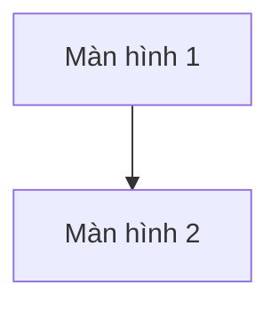

# [TÊN APP] — Luồng di chuyển màn hình

## 1. Sơ đồ tổng quan

## 2. Bảng chi tiết vào/ra từng màn

| # | Màn hình | Vào từ (nguồn) | Điều kiện/ghi chú khi vào | Ra tới (đích) | Điều kiện/ghi chú khi ra |
|---|---|---|---|---|---|

## 3. Quy tắc back-stack (lịch sử điều hướng) cần lưu ý

## 4. Điều hướng KHÔNG đổi route (overlay/dialog trong cùng 1 màn)
