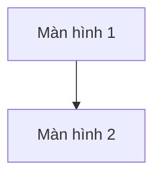

<!--
  CẦN LÀM GIỐNG file ví dụ: docs/example/02_LUONG_DI_CHUYEN_MAN_HINH.md
  (đường dẫn tương đối từ file này: ../example/02_LUONG_DI_CHUYEN_MAN_HINH.md)

  Đọc file ví dụ đó trước để tham khảo:
  - Sơ đồ tổng quan dạng ```mermaid flowchart``` (render được trên GitHub/nhiều công cụ markdown).
  - Bảng chi tiết vào/ra từng màn: Vào từ / Điều kiện khi vào / Ra tới / Điều kiện khi ra.
  - Mục quy tắc back-stack (lịch sử điều hướng) — chỗ nào cố tình xoá lịch sử để chặn nút Back, chỗ
    nào cố tình GIỮ lịch sử.
  - Mục phân biệt điều hướng thật (đổi màn) với overlay/dialog mở tại chỗ (không đổi màn).

  Xoá toàn bộ khối comment này sau khi đã đọc, rồi thay bằng nội dung thật của app mới.
-->

# [TÊN APP] — Luồng di chuyển màn hình

## 1. Sơ đồ tổng quan



## 2. Bảng chi tiết vào/ra từng màn

| # | Màn hình | Vào từ (nguồn) | Điều kiện/ghi chú khi vào | Ra tới (đích) | Điều kiện/ghi chú khi ra |
|---|---|---|---|---|---|
| 1 | [ĐIỀN] | | | | |

## 3. Quy tắc back-stack (lịch sử điều hướng) cần lưu ý

<!-- [ĐIỀN] Chỗ nào xoá sạch lịch sử (chặn back), chỗ nào cố tình giữ lịch sử — và LÝ DO. -->

## 4. Điều hướng KHÔNG đổi route (overlay/dialog trong cùng 1 màn)

<!-- [ĐIỀN] Liệt kê panel/dialog/bottom-sheet mở tại chỗ, không tính là "chuyển màn" thật. -->
